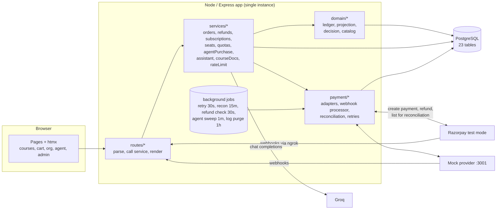
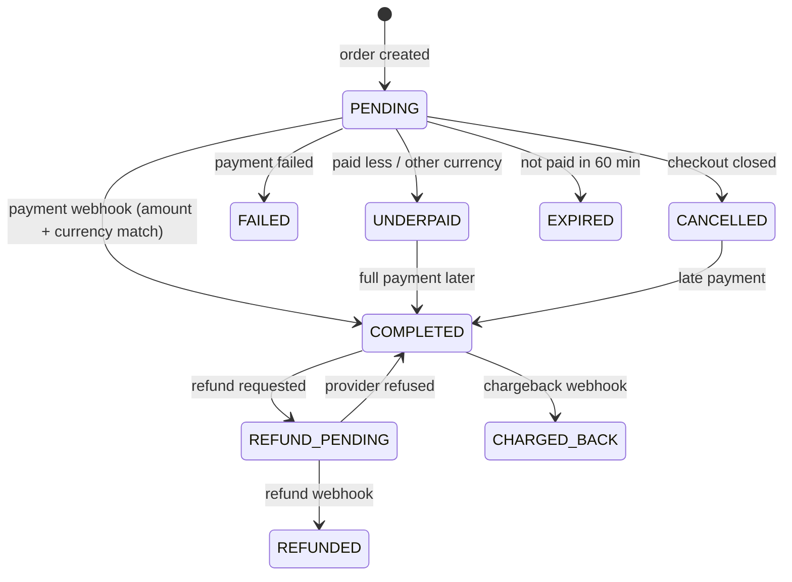
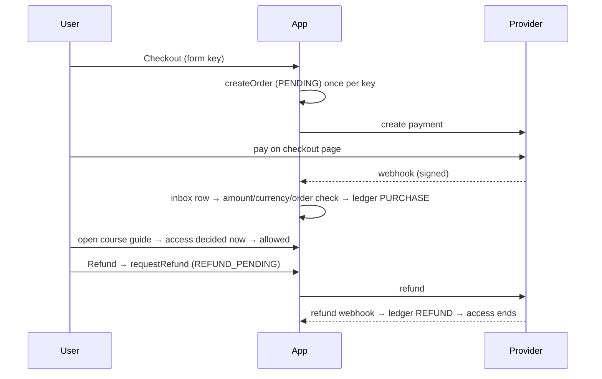
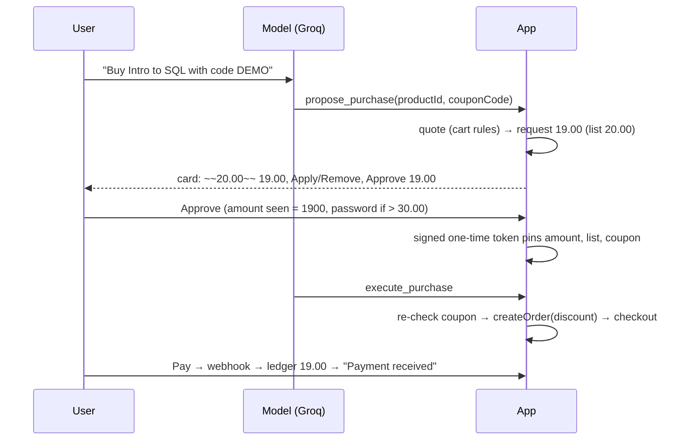

# LEARNX (streamflix): end-to-end project overview and decision log

*Written 2026-11-20, updated 2026-11-21. Covers the whole project from Phase 0 (1 October 2026) to the
final revision. All decisions (ADR-000 to ADR-024) are in [Architecture_Decision_Records.md](Architecture_Decision_Records.md);
Section 8 lists them in one line each. Test evidence is in [E2E-TESTS.md](E2E-TESTS.md).*

## Contents

1. [What the project is](#1-what-the-project-is)
2. [Milestones and where each is met](#2-milestones-and-where-each-is-met)
3. [Timeline: earlier sessions compared with this one](#3-timeline-earlier-sessions-compared-with-this-one)
4. [Architecture](#4-architecture)
5. [Components in detail](#5-components-in-detail)
6. [Data model](#6-data-model)
7. [Key flows](#7-key-flows)
8. [Decision log](#8-decision-log)
9. [Security model](#9-security-model)
10. [Testing and evidence](#10-testing-and-evidence)
11. [Configuration](#11-configuration)
12. [Known limits and what was deliberately not done](#12-known-limits-and-what-was-deliberately-not-done)

---

## 1. What the project is

LEARNX is a course storefront built to answer one brief: *a provider-neutral payments, subscriptions,
entitlements and agent-mediated commerce platform*. It sells single courses, an All-Access pass, enterprise
seat packs and free (admin or scholarship) access. Payments come from Razorpay in test mode or from a local
mock provider. The central idea is that **access is never stored as a flag**: every purchase, refund,
chargeback, grant, seat and subscription period is an event in an append-only ledger, and "can this user open
this course right now?" is computed from that history at the moment it is asked.

Around that core sit the parts the brief asks for. Payment adapters hide provider differences. A webhook inbox
makes unreliable provider messages safe to process. Reconciliation compares provider records with the ledger
and repairs or escalates gaps. Commercial rules cover coupons, seats and the pass lifecycle; usage quotas
protect an expensive feature. Finally, an AI purchase assistant can buy on the user's behalf only after an
explicit, signed, one-time approval.

The stack is deliberately plain: Node.js and Express, PostgreSQL, server-rendered HTML with htmx, no front-end
build step. Everything runs locally; ngrok is used only to receive Razorpay webhooks.

## 2. Milestones and where each is met

| Milestone | Requirement (short) | How it is met | Main code | Proven by |
|---|---|---|---|---|
| **M1** Transaction model | Purchase, subscription, seat, grant, refund, chargeback, expiry independent of provider payloads | 12 ledger event types with source, actor, reason; reversals must reference the event they undo; expiry computed from period end | `src/domain/*` | `verify-domain-memory`, `verify-domain-pg` |
| **M2** Adapter + idempotency | Sandbox provider drives the flow; duplicate, late, reordered webhooks change nothing twice | Adapter contract; inbox keyed by provider event id; unique ledger event ids; retries with backoff; refund-before-purchase answered 503 and retried | `src/payment/*`, `routes/webhooks.js` | `verify-m2-m6`, `verify-failure-switches` |
| **M3** Entitlement ledger | Access from auditable history, not flags | Projection rebuilt from the ledger at startup; database triggers block UPDATE/DELETE/TRUNCATE | `domain/projection.js`, `decision.js` | `verify-domain-pg` |
| **M4** Commercial rules | Coupons, seats, subscription lifecycle with clear conflict and expiry rules | One coupon per order, discount split across lines; seat packs counted from the ledger; stacked pass periods, one renewal at a time, full-pass refund | `services/pricingEngine.js`, `seats.js`, `subscriptions.js` | `verify-m4`, `verify-idempotency` |
| **M5** Usage quotas | Per-user or pooled limits, safe under concurrency | One atomic upsert per request; request keys make retries free; credits returned on failure | `services/quotas.js` | `verify-m5` |
| **M6** Refund + reconciliation | Detect provider/ledger disagreement, repair or escalate | Webhook-driven refunds; scheduled reconciliation replays missing events through the normal pipeline; refused or suspicious cases escalated | `payment/reconcile.js` | `verify-m2-m6` |
| **M7** Agent purchase | Propose, explicit authorisation, preserve item/merchant/amount, reject tampered/replayed/expired/cancelled | Purchase requests with signed one-time approval (JWT + nonce); LEARNX Assistant (Groq) with no approve tool; coupons pinned in the approval | `services/agentPurchase.js`, `assistant.js`, `routes/agent.js` | `verify-m7`, `verify-assistant`, `verify-agent-coupons` |
| **M8** Audit + failure validation | Full history inspectable; injected failures converge | Activity page, request history, reconciliation page, assistant log; mock failure switches (duplicate, delay, reorder, drop, refund 500) | `mock-provider/`, admin pages | `verify-failure-switches` (6/6), E2E sections 4, 11 |

The brief's "done when" is covered end to end in the browser runs recorded in `E2E-TESTS.md`:
- one-time, subscription and seat flows;
- access removed on refund and on expiry (watched live with 2-minute demo passes);
- lost and duplicate events reconciled;
- an agent-authorised purchase that never touches the ledger directly.

## 3. Timeline: earlier sessions compared with this one

| Period | Commits | What was built | State at the end |
|---|---|---|---|
| 1–3 Oct (Phase 0–1) | `2a1f4c3` → `7e58a48` | Ledger → projection → decision engine; ledger moved to PostgreSQL; mock checkout and webhook inbox | Core event-sourced access working |
| 27 Oct – 11 Nov | `a3504b5` → `4175692` | Razorpay test mode, cart, admin panel, coupons, global subscription, multi-item orders, admin grants | A usable store |
| 12–14 Nov (earlier chats) | `b020c80` → `7d1b6d3` | M1 refinement, webhook-driven refunds, retries (M2), reconciliation (M6), seats + renew/cancel (M4), quotas (M5), failure switches (M8) | All non-agent milestones done |
| 15–19 Nov (earlier chats) | `7dd197d` | M7 v1: a *simulated* agent, review page, signed approval, agent keys, JSON API, step-up password; saved-card mandates tried and removed | Agent flow driven by buttons, not AI |
| 19–20 Nov (this session) | `4cc86c0` (assistant, assistant log, pass rules, seat return, idempotency), `1c53ec8` (guides, payment matching, security, rate limits, agent coupons), `f7dcab5` (clean-up, org notices, docs) | Everything in the next table | Real AI agent, hardened payments, paid content, cleaner code |

**What changed in this session, compared with where the earlier chats left off:**

| Area | Before (end of earlier chats) | Now |
|---|---|---|
| Agent | Simulated agent with buttons; agent keys and `/agent/api/*` | LEARNX Assistant on Groq; purchase cards in the chat with Approve / Pay / Cancel; simulated agent and API removed |
| Chat UX | n/a | Finished cards fade out after 5 s; each payment keeps a one-line result; no tool chatter; model text cleaned (zero-width characters, leaked planning) |
| Mock via agent | Server-side instant charge | Real mock checkout page, back to `/agent` |
| Monitoring | Assistant chat only | Append-only **assistant log** with admin page (tokens, errors, flags) |
| Pass rules | Renew any time; refund only the latest period | One renewal at a time; Cancel renewal refunds a paid renewal; Refund refunds every payment of the pass and ends free periods |
| Seat checkout | Returned to `/courses` | Returns to `/org` with a result note; failed attempts fade and stop stacking |
| Paid content | None (Access only showed a status) | One **course guide** per course, published by the admin, opened only with access, closed live on refund or pass end |
| Idempotency | Webhooks and ledger only | Also one order per checkout click and one grant per admin form |
| Payment safety | Provider amount trusted | Paid amount **and currency** must match the order; purchase must name an order of that user |
| Secrets & auth | Example secrets in `.env`; no limits | Secrets rotated; login, sign-up and approval-password limits; HS256 pinned; generic errors |
| Coupons | Cart only | Also on agent purchases, pinned in the signed approval |
| Code | Duplicated helpers, tests inside `src/` | Shared `orders.js`, `refunds.js`, display helpers; tests in `test/`; dead files removed |
| Test suites | 7 | 11 in `npm run verify` (+ live failure-switch run) |

## 4. Architecture

**Layers and rules.**
- **`domain`** knows nothing about providers, agents or HTTP. It turns events into access decisions.
- **`payment`** turns provider messages into domain events and is the only code that talks to providers.
- **`services`** hold the use cases shared by several routes.
- **`routes`** read the request, call a service and render HTML.

A check during the clean-up confirmed there are no import cycles between these modules.

**Single instance.** The projection, the course-guide list and the rate-limit counters live in memory, and the
background jobs run inside the web process so their ledger writes reach that projection. The README states that
only one app instance should run.

## 5. Components in detail

### 5.1 Domain (`src/domain`)

| File | Role |
|---|---|
| `ledger.js` | Validates and appends events (unique id, valid type, required references, catalog product); returns `DUPLICATE_EVENT` / `EVENT_ID_CONFLICT` instead of failing on repeats |
| `stores/pgLedgerStore.js`, `memoryLedgerStore.js` | Same interface, PostgreSQL for the app, memory for a fast test |
| `projection.js` | Keeps current entitlements per user: course grants, and pass periods laid end to end |
| `decision.js` | `evaluateAccess(user, product)`: allowed or a reason (`PURCHASE_REFUNDED`, `SUBSCRIPTION_EXPIRED`, `SEAT_UNASSIGNED`, …) computed at request time |
| `catalog.js`, `catalogLoader.js` | Products from the `courses` table; `get()` finds by id or slug |

### 5.2 Payments (`src/payment`)

| File | Role |
|---|---|
| `adapter.js`, `registry.js` | The provider contract and the list of providers |
| `adapters/razorpay.js` | Orders, HMAC-verified webhooks, refunds, reconciliation reads |
| `adapters/mock.js` | Same contract for the mock; shared secret compared in constant time; no built-in default |
| `service.js` | `initiatePayment`, `initiateRefund` for any provider |
| `webhookProcessor.js` | Inbox row → normalised event → per-line ledger events; refuses purchases that are underpaid, in the wrong currency, or not for an order of that user |
| `retryWorker.js` | Exponential backoff, DEAD after 8 attempts |
| `reconcile.js` | Provider ↔ ledger comparison; replays lost events; escalates mismatches, refused payments, DEAD rows |

### 5.3 Services (`src/services`)

| Service | Responsibility |
|---|---|
| `orders.js` | The only place an order and its lines are written; checks line amounts add up |
| `refunds.js` | The only place a provider refund is requested (claim → ask → reopen if refused) |
| `checkoutOnce.js` | One order per checkout click (form key, advisory lock, stored checkout link) |
| `subscriptions.js` | Pass state, one renewal at a time, Cancel renewal, full-pass refund, ending free periods |
| `seats.js` | Organization requests (learner asks, admin approves or rejects), managers, seat packs, assign/unassign/reassign under an advisory lock, seats held by a member |
| `pricingEngine.js` | Coupons and identity pricing; discount allocation across lines |
| `quotas.js`, `aiSummary.js` | Daily credits (user or organization pool) for the demo AI summary |
| `agentPurchase.js` | Purchase requests: propose, coupon quote, approve (signed token), execute, sweep, history |
| `assistant.js` | Groq chat loop, tools, reply cleaning, outcome lines, assistant log |
| `courseDocs.js`, `markdown.js` | Course guides (publish/remove with history) and a safe Markdown renderer |
| `rateLimit.js` | Login, sign-up and step-up limits, counted before the password check |
| `cartSession.js`, `refundStatus.js`, `agentKeys.js` | Coupon cookie, "refund pending" check, the assistant's own agent identity |

### 5.4 Routes and pages (`src/routes`, 75 handlers)

| Route file | Pages / endpoints |
|---|---|
| `auth.js` | Login, register (admin email reserved), logout |
| `courses.js` | Course list, cards, pass banner, Access, Activity (user's ledger), access re-check of an open Courses page |
| `cart.js` | Cart, coupons, checkout, cancelled checkout |
| `checkout.js` | Single checkout, course and pass refunds, Razorpay checkout page |
| `subscription.js` | Renew, Cancel renewal |
| `org.js` | Organization page (request, manager tools, read-only seats of a member), seat checkout, assign/unassign/reassign, pack refund; admin Organizations page (approve / reject requests, read-only organizations) |
| `ai.js` | Quota-limited AI summary |
| `agent.js` | Assistant chat, purchase cards, coupon field, approve/pay/cancel, request page |
| `content.js` | Admin Course content; learner course guide (access-checked, re-checked every 5 s) |
| `admin.js` | Dashboard, users and grants (automated-test accounts counted apart), pricing rules, reconciliation, assistant log |
| `webhooks.js` | Provider webhooks (raw body, verified, into the inbox) |
| `commerce.js` | Access/ledger JSON; dev-only event route (off by default) |

### 5.5 Mock provider (`mock-provider/server.js`)

A small Express app with a checkout page (Pay / Simulate Failure / Cancel), signed webhooks with re-sends,
refunds, records in `data.json` for reconciliation, failure switches, and an allow-list of return targets
(`agent`, `org`).

## 6. Data model

| Group | Tables | Notes |
|---|---|---|
| Catalog & users | `users`, `courses`, `pricing_rules` | Courses, the pass and coupons |
| Shopping | `cart_items`, `orders`, `order_line_items` | Orders carry subtotal, discount, final amount, applied rule, `refund_scope`, `checkout_key`, `checkout_url` |
| Ledger | `commerce_ledger` | Append-only (triggers); one reversal per event |
| Webhooks & recon | `webhook_inbox`, `recon_runs`, `recon_issues` | Inbox unique per provider event id |
| Organizations | `organizations`, `org_managers`, `org_requests`, `org_seat_pools` | Requests (pending / approved / rejected), managers, pack status; seats themselves are ledger events |
| Quotas | `usage_counters`, `usage_events` | Atomic counters + per-request audit |
| Agent | `purchase_intents`, `intent_events`, `agent_keys` | Requests (with list price, discount, coupon), full history |
| Assistant | `assistant_messages`, `assistant_log` | Chat memory (user can clear) vs. append-only admin log |
| Content | `course_docs`, `course_doc_events` | Published guides and their append-only history |

## 7. Key flows

### 7.1 Purchase and refund (any provider)

### 7.2 Agent purchase with coupon

The model never sees the approval token and has no tool that approves. Everything it proposes is
re-checked on the server.

## 8. Decision log

All decisions are in [Architecture_Decision_Records.md](Architecture_Decision_Records.md) (25 records,
restructured on 21 Nov 2026).

| ADR | Decision | In one line |
|---|---|---|
| 000 | Methodology reaffirmed (9 Oct 2026) | Own provider-neutral core (ledger, projection, decision) on Node.js, PostgreSQL and htmx; built one component at a time |
| 001 | Providers behind an adapter contract | Every provider's events become one internal event; the domain imports no provider code |
| 002 | Append-only ledger in PostgreSQL | Access is computed from events; UPDATE/DELETE blocked; one reversal per event |
| 003 | Webhook inbox | Every delivery saved first, unique per (provider, event id); a repeat is ignored |
| 004 | Retries with backoff | 30 s … 1 h, DEAD after 8 attempts, escalated by reconciliation |
| 005 | Refunds wait for the provider | Access ends only when the refund webhook confirms it |
| 006 | Reconciliation replays | Lost events are replayed through the webhook path; the rest become issues (incl. `PAYMENT_REFUSED`) |
| 007 | Sandbox providers | Razorpay test mode plus a mock with failure switches |
| 008 | Pass as stacked paid periods | Manual renewal, one renewal at a time, Refund covers the whole pass |
| 009 | Seats counted from the ledger | Seats in use counted from events under a lock; never over capacity |
| 010 | Atomic quotas | One conditional UPDATE plus a request key; retries counted once |
| 011 | Signed one-time approval (AP2-inspired) | Server-priced, user-approved, 5-minute single-use token; approve checks the shown amount and password rule in one update |
| 012 | Untrusted LLM assistant | Groq model with a few server tools and no approve tool |
| 013 | Agent pays through checkout | Saved-card mandates tried and removed (not on the Razorpay test account) |
| 014 | Assistant log | Append-only log of every turn, admin-only, 90 days |
| 015 | One order per click | Server-checked form keys for checkout and admin grants |
| 016 | Course guides checked per request | Guide and Courses page re-check access every 5 s |
| 017 | Payment must match its order | Same user, full amount, same currency, or nothing is granted |
| 018 | Security hardening | Rotated and checked secrets, password-guess limits, generic errors |
| 019 | Coupons fixed in the approval | The user pays exactly what they approved |
| 020 | Seat-lock limit (proposed) | Known freeze under 10+ simultaneous assignments; fix prototyped, not in the code |
| 021 | Two baselines | Naive and careful baselines on the same workloads |
| 022 | Admin doesn't shop | Admin navbar only; shop pages closed to the admin |
| 023 | Organizations by request | Learner requests, admin approves, manager assigns, members read-only |
| 024 | Late refund webhooks | A refund pending over 90 s is confirmed with the provider |

## 9. Security model

| Threat | Control |
|---|---|
| Forged session / admin | Random `JWT_SECRET`, HS256 pinned, admin email reserved at sign-up |
| Forged or altered payment | Razorpay HMAC; mock shared secret (no default, constant-time); amount, currency and order owner checked; dev route off |
| Duplicates and races | Inbox and ledger unique ids; conditional updates; advisory locks; one order per click; atomic approval |
| Password guessing | Limits per email+IP, per email, per IP; step-up limit per user |
| Agent misuse / prompt injection | No approve tool; server sets price; token never reaches the model; coupons validated; history of every attempt |
| Content leakage | Access decided per request; `no-store`; no title without access; escaped Markdown |
| Information leaks | Generic errors with reference; passwords never logged; request log off by default |

A 30-case attack script plus two independent read-only reviews found the gaps that ADR-017 and ADR-018 close.
After the fixes, the live re-run found 0 leaks.

## 10. Testing and evidence

| Suite (`test/`) | Covers |
|---|---|
| `verify-domain-memory`, `verify-domain-pg` | Ledger rules, projection, reversals, restart, append-only triggers |
| `verify-m2-m6` | Retries, backoff, DEAD, concurrent deliveries, reconciliation repairs and escalations |
| `verify-m4` | Seats, pass lifecycle, full-pass refund, underpaid / wrong-currency / no-order payments |
| `verify-m5` | Quotas under concurrency, pooled limits, release |
| `verify-m7` | Approval tampering, replay, expiry, cancel, wrong agent, step-up, price changes |
| `verify-assistant` | Tools with a fake model, cards, limits, model failures, assistant log, admin page |
| `verify-idempotency` | One order / pack / grant per click, org notices |
| `verify-content` | Guides: publish, access, refund, pass end, admin preview, escaping |
| `verify-agent-coupons` | Every coupon edge case, stale cards, step-up race, assistant passing codes |
| `verify-security` | Rate limits (incl. parallel and proxied), forged sessions, dev route, errors, mock secret |
| `verify-failure-switches` (live) | Duplicate, delay, drop payment, drop refund, reorder, refund API 500 |

`npm run verify` runs the 11 database suites. The browser and live runs (`E2E-TESTS.md` sections 1–21) cover:
- Razorpay test cards, ngrok webhooks and live pass expiry;
- guides and the Courses page closing access within 5 s of a refund or an admin revoke;
- organizations: request, approval, seat packs and read-only members;
- a late refund webhook confirmed with the provider;
- coupon purchases with the real model;
- every fix above.

## 11. Configuration

| Setting | Purpose (default) |
|---|---|
| `DATABASE_URL`, `JWT_SECRET`, `ADMIN_EMAIL` | Database, session signing, admin account |
| `RAZORPAY_*`, `MOCK_WEBHOOK_SECRET`, `MOCK_PROVIDER_URL`, `STREAMFLIX_URL` | Providers (test mode only) |
| `GROQ_API_KEY` | Assistant model |
| `SUB_DURATION_MINUTES` | Demo: pass periods in minutes |
| `RECON_*`, `WEBHOOK_RETRY_INTERVAL_MS`, `AGENT_*` | Reconciliation, retries, agent rules |
| `ASSISTANT_LOG_DAYS`, `ASSISTANT_CARD_DONE_MS` | Log retention (90), card fade (5000) |
| `RENEW_PENDING_MINUTES` | Unpaid renewal blocks Renew (30) |
| `LOGIN_*`, `REGISTER_MAX_PER_IP`, `STEPUP_MAX_FAILS`, `TRUST_PROXY` | Guessing limits, proxy trust (`loopback`) |
| `ORG_NOTICE_FADE_MS`, `ORG_UNPAID_SHOW_SECONDS` | Org notices (6000 ms, 120 s) |
| `CONTENT_DIR`, `ENABLE_DEV_EVENTS`, `ADMIN_ALLOW_REGISTER`, `LOG_REQUESTS` | Guides folder; dev-only switches |

After pulling changes: run `npm run db:init` (it is safe to re-run), then restart the app **and** the mock provider.

## 12. Known limits and what was deliberately not done

- **Single instance:** in-memory projection, guide list and rate limits.
- **Test database:** the suites run against the dev database and clean up after themselves; there is no separate test database or CI.
- **Mock provider:** its admin pages have no login (local tool only).
- **Unverified emails:** domain-targeted coupons and identity pricing trust the registered address; coupons have no redemption limits.
- **No refund window** (buy, read, refund is possible).
- **Not adopted:** AP2 with user-held keys, saved-card mandates (need Razorpay support), and the larger restructuring (config module, splitting `admin.js`/`views.js`, lint, `node:test`). The owner decided the larger restructuring wasn't needed.
