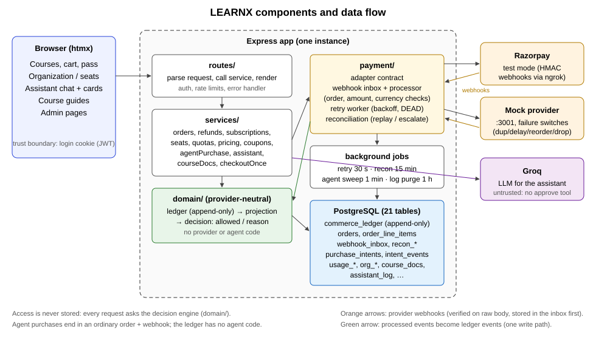
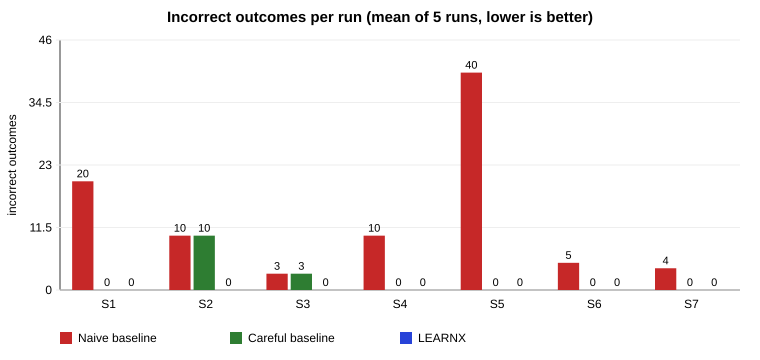
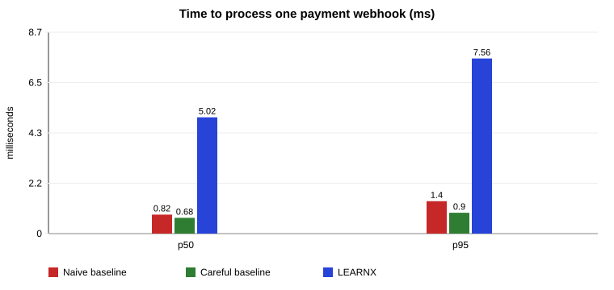

# LEARNX: a provider-neutral payments, subscriptions, entitlements and agent-mediated commerce platform

| | |
|---|---|
| **Course / project** | CS5903, project ID **7** |
| **Group** | **46** (single member) |
| **Member** | **Ankith Deegoju** (GitHub: ANKITHDEEGOJU) |
| **Repository** | https://github.com/ANKITHDEEGOJU/proj-pic |
| **Final revision** | tag `cs5903-final-2026`, commit `<SHA>` |
| **Demo** | local (see README "Running"); demo video: `<LINK>` |

## Executive summary

**Problem.** A learning service sells courses, a subscription pass, enterprise seat packs and free
(admin or scholarship) access. Provider events arrive late, twice, out of order or not at all, yet access
must stay correct through refunds, chargebacks and expiry. An AI agent may buy only with explicit,
auditable approval.

**Solution.** LEARNX (Node.js/Express, PostgreSQL, htmx):
- access is never stored; it is computed from an append-only event ledger;
- providers (Razorpay test mode, a local mock) sit behind one adapter, with a deduplicating webhook
  inbox, retries and reconciliation;
- coupons, seats, stacked pass periods and usage quotas;
- the assistant (an LLM) only proposes purchases; the user approves with a signed, one-time token
  pinning item, amount and coupon.

**What works today.** M1–M8 are implemented and verified: 11 automated suites, a failure-injection run
(6/6), browser end-to-end runs with Razorpay test cards, and a comparison with two baselines: a naive
one was wrong in 7 of 7 failure workloads, a careful one in 2 (out-of-order and lost events), LEARNX
in none.

**Completion state.** Complete for the approved scope. One known defect (a burst of 10+ simultaneous
seat assignments can freeze the app). Not implemented: automatic recurring billing and multiple app
instances.

## 1. Problem, scope & success criteria

**Actors.**

| Actor | Role |
|---|---|
| Learner | Buys, refunds, renews, uses the assistant, opens guides |
| Organization owner | Buys seat packs and assigns seats |
| Admin | Grants and revokes access, manages pricing, runs reconciliation, reads the assistant log, publishes guides; uses only the admin pages (no shopping) |
| Payment providers | Razorpay test mode and a local mock |
| AI assistant | An untrusted agent |

**Problem statement.** Build a commerce layer in which access to courses and features stays correct and
explainable whatever the payment provider does, and in which an agent can buy only with explicit,
verifiable, single-use user authorisation.

**In scope:**
- one-time course purchases, the All-Access pass (stacked periods, manual renewal), seat packs, free grants;
- coupons and identity pricing;
- refunds and chargebacks; reconciliation;
- usage quotas;
- agent-mediated purchase;
- paid course guides as the protected content.

**Out of scope:**
- real money and production keys (the brief forbids them);
- automatic recurring billing;
- multi-instance deployment;
- full AP2 interoperability (ADR-012).

**Assumptions and constraints:**
- sandbox or mock providers only;
- the core entitlement system must not depend on any provider or on AP2;
- all state changes must be idempotent and auditable;
- a single app instance.

**Approved milestones and acceptance tests.**

| Milestone | Acceptance criterion | Automated acceptance test |
|---|---|---|
| M1 | Purchase, subscription, seat, grant, refund, chargeback, expiry independent of provider payloads | `test/verify-domain-memory.js`, `test/verify-domain-pg.js` |
| M2 | Duplicate, delayed, reordered webhooks cannot duplicate money or access changes | `test/verify-m2-m6.js`, `test/verify-failure-switches.js` |
| M3 | Access derived from auditable ledger history, not flags | `test/verify-domain-pg.js` |
| M4 | Coupons, seat allocation/reassignment, subscription lifecycle with conflict and expiry rules | `test/verify-m4.js`, `test/verify-idempotency.js` |
| M5 | Per-user or pooled limits safe under concurrency | `test/verify-m5.js` |
| M6 | Provider/ledger disagreement detected, repaired or escalated | `test/verify-m2-m6.js` |
| M7 | Propose, explicit authorisation, preserve item/merchant/amount, reject tampered/replayed/expired/cancelled | `test/verify-m7.js`, `test/verify-assistant.js`, `test/verify-agent-coupons.js` |
| M8 | Full history inspectable; injected failures converge | `test/verify-failure-switches.js`, `docs/E2E-TESTS.md` |

**"Done when" workflow.** A sandbox demonstration:
- completes one-time, subscription and seat flows;
- changes access after refund and expiry;
- reconciles deliberately lost and duplicate events;
- shows an agent-authorised purchase without coupling the ledger to the agent protocol.

**Target metrics:**
- 0 incorrect access or money outcomes on every failure workload of §4;
- every acceptance suite passing;
- reconciliation leaving 0 unexplained open issues.

## 2. Related work, baselines & alternatives

**Prior systems and ideas:**
- **Event sourcing** (Fowler 2005; Young, CQRS): state as a projection of an immutable event log. This is the basis of the ledger and projection (ADR-002).
- **Provider webhook guidance** (Razorpay and Stripe documentation): verify signatures on the raw body; expect duplicates, retries and out-of-order delivery; deduplicate by event id; reconcile with the provider's API.
- **The transactional inbox pattern** for exactly-once effects on at-least-once delivery (ADR-004).
- **Open-source billing and orchestration:** Juspay Hyperswitch (Apache-2.0, payment orchestration), Lago and Kill Bill (open-source billing). They were considered as alternatives to writing our own adapter layer (ADR-001). They are heavier to run and don't provide course-level entitlements, which were the core of the brief.
- **Agent Payments Protocol (AP2, Google, 2025):** signed mandates (intent, cart, payment) for agent purchases. Our approval token follows its cart-mandate idea inside one application (ADR-012); full AP2 needs mandate-aware wallets and networks that aren't available in a sandbox.
- **OpenAI-compatible tool calling** (used through Groq's API) for the assistant (ADR-013).

**Approaches compared** (the guide asks for at least two):

| Approach | Description | Why it was or wasn't selected |
|---|---|---|
| A. Access flags (CRUD) | Each webhook updates a `has_access` flag and a payments table | Simple and fast, but no history; breaks under duplicates, reordering and races unless each case is guarded by hand. **Used as the two working baselines** (§4). |
| B. Payment orchestration product + flags | Hyperswitch or similar in front of the providers | Provider-neutral, but heavy to run, and still needs custom entitlements and the same idempotency work |
| **C. Own adapter contract + webhook inbox + append-only ledger + projection** | **Selected** | Meets M1–M3 directly, keeps the domain provider- and agent-free, and the database can enforce idempotency (unique ids, one reversal, append-only triggers) |

**Reused frameworks** (all used unmodified):

| Package | Version | Licence |
|---|---|---|
| express | 4.22.3 | MIT |
| pg | 8.23.0 | MIT |
| jsonwebtoken | 9.0.3 | MIT |
| bcryptjs | 2.4.3 | MIT |
| cookie-parser | 1.4.7 | MIT |
| dotenv | 16.6.1 | BSD-2-Clause |
| razorpay | 2.9.8 | MIT |
| htmx | 1.9.12 (CDN) | BSD-2-Clause |

PostgreSQL 17 is the database. Everything else is our own code: domain, payments, services, mock provider,
tests, evaluation.

**Working baselines.** Two versions of approach A, on the same PostgreSQL server:
- **Naive** (`evaluation/baseline.js`): each webhook flips the flag and records revenue; limits are "read, then write".
- **Careful** (`evaluation/baseline-careful.js`): approach A plus the usual webhook advice: one row per payment id (duplicates ignored), payment must match the order's amount and currency, race-safe quota, seat and approval updates. It still has no event history, no handling of a refund that arrives before its payment, and no reconciliation.

The careful baseline keeps the comparison honest: it shows which failures ordinary care already
prevents, and which ones need LEARNX's design.

## 3. Architecture & implementation

| Component | Responsibility | Interfaces |
|---|---|---|
| `src/domain` | Ledger (12 event types, references, one reversal per event, append-only), projection (course grants, stacked pass periods), decision engine (allowed or reason code, computed at request time) | `appendEvent`, `evaluateAccess`; no provider or agent imports |
| `src/payment` | Adapter contract (create payment, verify webhook, normalise, refund, list/fetch for reconciliation); webhook processor; retry worker; reconciliation | `POST /webhooks/:provider`; Razorpay HMAC, mock shared secret |
| `src/services` | Use cases: `orders` (only place orders are written), `refunds` (only place refunds are requested), `subscriptions`, `seats`, `quotas`, `pricingEngine`, `agentPurchase`, `assistant`, `courseDocs`, `rateLimit`, `checkoutOnce` | Called by routes |
| `src/routes` | 71 HTTP handlers in 12 files (auth, courses, cart, checkout, subscription, org, ai, agent, content, admin, webhooks, commerce) | HTML (htmx) and JSON |
| `mock-provider/` | Checkout page, signed webhooks with resend, refunds, records for reconciliation, failure switches | `POST /pay/:id/confirm`, `/api/*`, `/admin/failure-mode` |

**Data stores.** PostgreSQL, 21 tables: ledger, orders and lines, webhook inbox, reconciliation runs and
issues, organizations and seat pools, usage counters and events, purchase requests and their history,
assistant messages and log, course guides and their history. Order states: PENDING → COMPLETED /
UNDERPAID / FAILED / CANCELLED / EXPIRED → REFUND_PENDING → REFUNDED / REFUND_FAILED, plus CHARGED_BACK.

**External dependencies:** Razorpay test mode (free), Groq (free tier; Gemini optional fallback), ngrok (to
receive Razorpay webhooks locally).

**Trust boundaries:**
- **Browser to app:** an HttpOnly JWT cookie (HS256, random secret); password-guessing limits; admin rights by `ADMIN_EMAIL` (the address can't be registered); the admin account has its own navbar and can't use the shop pages or buy, so the ledger never shows the admin as a customer (ADR-033).
- **Provider to app:** signed webhooks; a payment grants nothing unless it matches an order of that user in amount and currency.
- **Model to app:** the model is untrusted. It has no approve tool, the server sets prices, and the approval token never reaches the model.

**Major decisions** (`docs/Architecture_Decision_Records.md`, ADR-000 to ADR-033):

| Topic | ADRs |
|---|---|
| Foundation | ADR-001 (adapters), 002 (ledger), 003 (PostgreSQL), 004 (inbox) |
| Refunds and reconciliation | ADR-006, 007 |
| Commercial rules | ADR-009, 019 (pass), 010 (seats), 011 (quotas); ADR-031 (seat freeze, proposed fix, not implemented) |
| Agent purchases | ADR-012, 013, 027, 028 |
| Payment safety | ADR-022, 023 |
| Security | ADR-025, 026, 029, 033 (admin doesn't shop) |
| Evaluation method | ADR-000 (methodology), ADR-032 (two baselines) |

## 4. Methodology & experiment setup

**Evaluation questions:**
1. Does each acceptance criterion hold (automated suites)?
2. Under the failure modes the brief names (duplicate, late or reordered, lost events) and under concurrency
   and tampering, how many incorrect outcomes does LEARNX produce compared with the two baselines?
3. What does the extra safety cost in processing time?
4. Do the complete user workflows work in a browser against a real sandbox provider?

**Workloads** (`evaluation/run-evaluation.js`): the same workload is run against both baselines and LEARNX.

| ID | Workload | Correct outcome | Metric (incorrect outcomes per run) |
|---|---|---|---|
| S1 | Each payment webhook delivered 3×, shuffled, concurrently | One purchase and one charge per payment | Extra purchases recorded |
| S2 | Refund delivered before its purchase | No access after the refund | Users with access after refund |
| S3 | 30 % of payment webhooks dropped, then reconciliation | Every paying user has access | Paying users without access |
| S4 | Half pay 0.01, half the right number in JPY | No access | Users wrongly granted |
| S5 | 50 parallel quota requests, limit 10 | Exactly 10 accepted | \|accepted − 10\| |
| S6 | 6 parallel assignments to a 1-seat pack (below the 10 database connections; see §5) | Exactly 1 seat | Seats over capacity |
| S7 | One approval executed 5× in parallel | Exactly 1 order | Extra orders |
| S8 | Time to process one payment webhook | — | p50 / p95 (ms) |

**Data and provenance.** Synthetic: generated `eval_*@test.local` users, one course (Intro to SQL, 20.00 USD),
simulated provider payloads in Razorpay's format. No personal data.

**Not applicable (guide §6).** No model is trained, so training datasets, GPUs and model seeds don't
apply. The only model is the assistant's LLM (Groq `openai/gpt-oss-120b`, used as a service); it is not
part of the baseline comparison, because purchases are decided by server rules, not by the model.

**Setup:**

| Item | Value |
|---|---|
| Hardware | Intel Core i7-14700 (28 threads) |
| OS | Linux 6.17 |
| Software | Node.js 24.21.0; PostgreSQL 17.10 (local) |
| Parameters | 10 users per workload; 5 repetitions; seed 42 (seeded shuffles) |
| Command | `node evaluation/run-evaluation.js --runs 5 --size 10 --seed 42` (or `npm run evaluate`) |
| Raw output | `evaluation/results/latest.json` and `raw-<timestamp>.json`, with environment and commit |

**Other evidence:**
- **`npm run verify`** runs the 11 suites against PostgreSQL.
- **`npm run verify:failures`** is the live failure-switch run: both servers, with the mock injecting duplicate, delay, drop, reorder and refund-500.
- **Browser runs** (`docs/E2E-TESTS.md`, 124 recorded cases and 20 defects) used Razorpay test mode with webhooks through ngrok, the real Groq model and test accounts. Passwords and test cards were typed only on localhost.

## 5. Results, observations & analysis

| Workload | Naive | Careful | LEARNX | Detail |
|---|---|---|---|---|
| S1 duplicates | 20 | 0 | 0 | Naive recorded 30 purchases and 600.00 USD instead of 10 and 200.00 (+200 %); careful and LEARNX exactly 10 and 200.00 |
| S2 reordered | 10 | **10** | **0** | Both baselines: all 10 refunded users kept access (the careful one ignores a refund for a payment it hasn't seen yet). LEARNX answered the early refunds "retry later" (HTTP 503) and applied them after the purchase |
| S3 lost webhooks | 3 | **3** | **0** | 3 of 10 payment webhooks dropped; LEARNX's reconciliation repaired all 3 (`MISSING_PURCHASE`); neither baseline notices |
| S4 tampered | 10 | 0 | 0 | Naive granted all; careful and LEARNX refused (amount or currency mismatch; LEARNX marks `UNDERPAID`) |
| S5 quota race | 40 | 0 | 0 | Naive accepted 50 of 50; careful and LEARNX exactly 10 |
| S6 seat race | 5 | 0 | 0 | Naive put 6 members in a 1-seat pack; careful and LEARNX exactly 1 |
| S7 approval replay | 4 | 0 | 0 | Naive created 5 orders from one approval; careful and LEARNX exactly 1 |

Incorrect outcomes per run, mean of 5 runs. Full table: `evaluation/results/RESULTS.md` and `summary.csv`.

**What this shows.** Duplicates, tampered amounts and races (S1, S4–S7) are handled by ordinary care,
so they don't by themselves justify LEARNX's design. What the careful baseline can't do is handle
**out-of-order events (S2)** and **lost events (S3)**: that needs somewhere to keep an event that can't be
applied yet (the inbox and retry worker) and a way to compare with the provider (reconciliation). LEARNX
also keeps the full event history behind every access decision, which this evaluation doesn't measure.

**Limits of this evaluation.**
- **The counts follow from the inputs** (S1's 20 = 10 payments × 2 extra copies). They show whether a design handles a failure, not how often it happens in production.
- **Runs are deterministic:** every count was identical in all 5 runs; only the timings vary.
- **S2 depends on a choice:** a baseline that answered "retry later" and relied on the provider resending would pass S2; that is LEARNX's mechanism.
- **Simulated provider, no HTTP:** webhooks go straight to the inbox and processor. Signature checks and the HTTP route are covered by `npm run verify:failures` (both servers, signed webhooks), not here.
- **Small:** 10 users per workload; not a load test.

**Cost (S8).** Processing one payment webhook took **p50 5.0 ms / p95 7.6 ms** in LEARNX versus
**0.8 / 1.4 ms** (naive) and **0.7 / 0.9 ms** (careful). The cost is the inbox write, order checks, per-line ledger events and
projection update. That is negligible next to provider latency (Razorpay refund confirmations arrived after
3–33 s in the browser runs).

**Automated suites.**
- `npm run verify`: 11 suites, all passing. They cover 131 named checks, including 3 concurrent replays (1 winner) and 25 parallel quota requests against a limit of 7 (exactly 7).
- `verify:failures`: 6/6.

**Browser end-to-end (selected):**
- **Cart with coupon:** 55.00 → 52.25, refund of the whole order.
- **Pass:** expiry observed at the exact end time; full refund across Razorpay + mock with a scholarship period ended.
- **Course guide:** closed in an open tab within 30 s of a refund, and at the exact pass end.
- **Agent purchase:** the real model passed coupon DEMO (20.00 → 19.00), and the ledger recorded 19.00.
- **Final reconciliation:** 57 mock and 22 Razorpay payments checked, with 0 unexplained issues.

**Failures found and fixed.** The work surfaced 20 user-visible defects (D1–D20) and several security
issues:
- an underpayment opened paid content;
- a dev route let users grant themselves access;
- the example secrets allowed forged admin sessions and webhooks;
- currency was not checked;
- parallel password guesses got past the limits;
- a coupon/password race.

All were fixed and covered by tests.

**Known defect found by the evaluation (not fixed).** The first S6 run used 10 simultaneous seat
assignments to one pack and froze the app: each waiting assignment holds a database connection, and the
assignment holding the lock needs more connections than the pool of 10 has left. The seat count stays
correct, but the app stops responding until restarted. A fix was prototyped and passed (ADR-031) but is
not in the submitted code; S6 is therefore run with 6 parallel assignments, and the defect is tracked as
issue 1 (§9).

**Tests not run:**
- no load test beyond these workload sizes;
- no multi-instance test (unsupported);
- Razorpay chargebacks (disputes) only through the mock and unit tests;
- the Gemini fallback only with a fake model;
- some ngrok-hosted mock checks were driven through the mock's endpoint, because of browser-extension permissions.

## 8. Current state, limitations & risks

| Area | State |
|---|---|
| M1–M8 features | **Working** (evidence above) |
| AP2 | **Partial:** AP2-inspired approval inside one app; no user-held keys, intent mandates or interoperability |
| Automatic recurring billing | **Missing:** needs Razorpay card mandates (not available on the test account; ADR-014) |
| Seat assignment under bursts | **Known defect:** 10 or more simultaneous assignments to one pack can freeze the app (ADR-031, issue 1) |
| Multi-instance deployment | **Missing:** in-memory projection, guide list, rate-limit counters and seat queue; background jobs in the web process |
| Coupon redemption limits, email verification, refund window | **Missing** |
| Admin view of quota usage; inbox retention policy | **Missing** |

**Risks and technical debt:**
- **Free-tier dependencies:** Groq rate limits make the assistant show "usage limit" messages; Gemini can be added as fallback.
- **Model output:** gpt-oss sometimes needs reply cleaning.
- **Test database:** tests run against the development database and clean up after themselves; ledger rows of test users stay (append-only).
- **Unused schema left behind:** columns from the removed saved-card experiment.
- **Mock provider:** its admin pages are unauthenticated (local tool).
- **Privacy:** chat messages and the course list are sent to the model provider; assistant logs keep messages for 90 days (admin-only).
- **Accepted design risk:** domain coupons trust unverified email domains.

Open items are tracked as GitHub issues: https://github.com/ANKITHDEEGOJU/proj-pic/issues (issues 1–5 match the tasks in §9).

## 9. Way forward

| # | Task (GitHub issue) | Start from | Rationale | Dependencies / blockers | Done when |
|---|---|---|---|---|---|
| 1 | Fix the seat-assignment freeze | `src/services/seats.js` (`withPoolLock`), ADR-031 prototype | A known defect that stops the whole app | None | 12 simultaneous assignments to a 1-seat pack finish in under 15 s with exactly 1 seat; S6 runs with 10 |
| 2 | Run more than one app instance | `src/domain/projection.js`, `src/services/rateLimit.js`, `src/services/seats.js` | Needed for availability beyond one machine | Task 1; PostgreSQL LISTEN/NOTIFY | Two instances behind a proxy pass `npm run verify` and S1–S7 with 0 incorrect outcomes |
| 3 | Separate test database and CI | `package.json` scripts, `test/` | Tests now share the development database | GitHub Actions with a PostgreSQL service | Every push runs the 11 suites on a fresh database, green |
| 4 | Email verification and coupon redemption limits | `src/routes/auth.js`, `src/services/pricingEngine.js` | Domain coupons trust unverified emails; coupons have no usage limit | An email-sending service (test mode) | A domain coupon is unusable before verification; a limited coupon is never redeemed past its limit under 50 parallel checkouts |
| 5 | User-held approval keys toward AP2 | `src/services/agentPurchase.js` (`signToken`), ADR-012 | Today the server signs approvals; a third party can't verify them | Passkey/WebAuthn support in the browser | An approval verifiable with the user's public key; replay and tamper tests still pass |

Automatic renewal is not in this list: it is blocked by the provider (no card mandates on the Razorpay
test account, ADR-014). Further extensions are tracked as issues 6–11, among them a **separate admin
area** (its own layout, and a per-user view of what a user can access and why) building on ADR-033.

## 10. Contributions, AI use & attribution

**Contributions.** Single-member group: all work is by **Ankith Deegoju**:
- design;
- implementation of every module;
- tests and evaluation;
- documentation.

Main commits (19 in total, 1 October to 20 November 2026; full history in the repository):

| Area | Commits |
|---|---|
| Ledger, projection, PostgreSQL ledger, webhook inbox (M1–M3) | [f379e0d](https://github.com/ANKITHDEEGOJU/proj-pic/commit/f379e0d), [e50d72d](https://github.com/ANKITHDEEGOJU/proj-pic/commit/e50d72d), [7e58a48](https://github.com/ANKITHDEEGOJU/proj-pic/commit/7e58a48) |
| Razorpay test mode, cart, coupons, pass, admin | [a3504b5](https://github.com/ANKITHDEEGOJU/proj-pic/commit/a3504b5), [d721958](https://github.com/ANKITHDEEGOJU/proj-pic/commit/d721958), [4175692](https://github.com/ANKITHDEEGOJU/proj-pic/commit/4175692) |
| Refunds, retries, reconciliation, seats (M2, M4, M6) | [b020c80](https://github.com/ANKITHDEEGOJU/proj-pic/commit/b020c80), [de14f79](https://github.com/ANKITHDEEGOJU/proj-pic/commit/de14f79), [03c9938](https://github.com/ANKITHDEEGOJU/proj-pic/commit/03c9938) |
| Quotas and failure switches (M5, M8) | [7d1b6d3](https://github.com/ANKITHDEEGOJU/proj-pic/commit/7d1b6d3) |
| Agent purchases and assistant (M7) | [7dd197d](https://github.com/ANKITHDEEGOJU/proj-pic/commit/7dd197d), [4cc86c0](https://github.com/ANKITHDEEGOJU/proj-pic/commit/4cc86c0), [1c53ec8](https://github.com/ANKITHDEEGOJU/proj-pic/commit/1c53ec8) |
| Clean-up and documentation | [f7dcab5](https://github.com/ANKITHDEEGOJU/proj-pic/commit/f7dcab5), [3e7cc05](https://github.com/ANKITHDEEGOJU/proj-pic/commit/3e7cc05) |

**AI use.** Claude (Anthropic), used through the Claude Code tool, was an assistant for implementation,
tests, documentation and reviews. The author:
- set the requirements and made every product decision: for example the full-pass refund, ending scholarship
  periods on refund, the return to `/org`, a single guide per course, coupons for agents, and declining a
  larger restructuring;
- ran the application and approved changes.

How AI-assisted work was checked:
1. Every change was covered by the automated suites (11 suites; run after each change).
2. Features were tested end to end in the browser against Razorpay test mode and the mock.
3. Independent read-only review passes (security; all changes) were run. Their findings were verified live
   before fixing.
4. The baseline evaluation (§5) was added to measure correctness rather than assume it, and a second, careful baseline was added after the first comparison was judged too easy to win.

The text of the three course guides (`content/*.md`) was drafted with AI assistance and reviewed by the
author. Inside the product, the LEARNX Assistant uses an LLM at runtime (Groq `openai/gpt-oss-120b`). That is
a product feature, distinct from development assistance.

**Third-party code and assets.** Only the npm packages listed in §2 (MIT / BSD-2-Clause) and htmx
(BSD-2-Clause, CDN). Payment and model services are used under their free and test terms. No real
user data was used: all test accounts are synthetic `@test.local` users.

## References & appendices

1. M. Fowler, "Event Sourcing", martinfowler.com, 2005.
2. Razorpay documentation: Webhooks, Refunds, Test mode and test cards (razorpay.com/docs).
3. Stripe documentation: "Best practices for using webhooks" (stripe.com/docs).
4. Google, "Agent Payments Protocol (AP2)", ap2-protocol.org, 2025.
5. Juspay Hyperswitch (github.com/juspay/hyperswitch); Lago (github.com/getlago/lago); Kill Bill (killbill.io).
6. htmx 1.9 documentation (htmx.org).

**Appendices (in the repository):**

| Appendix | Location |
|---|---|
| Architecture decision records | `docs/Architecture_Decision_Records.md` |
| End-to-end test report | `docs/E2E-TESTS.md` |
| Complete documentation | `docs/LEARNX-COMPLETE-DOCUMENTATION.md` |
| Evaluation scripts and raw results | `evaluation/` |
| Automated tests | `test/` |
| Setup, operations and demo walkthrough | `README.md` |
