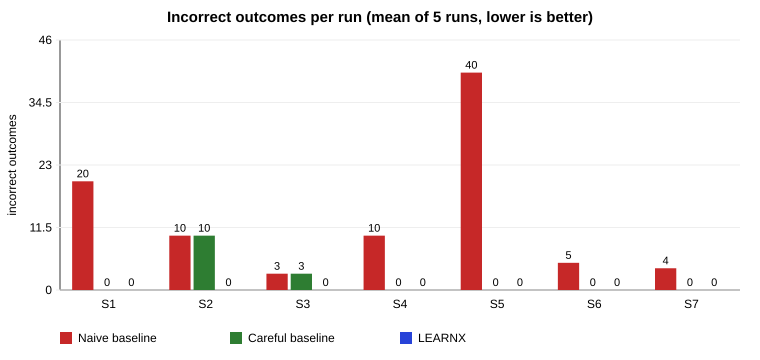
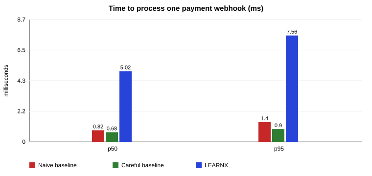

# Evaluation results

Generated by `node evaluation/run-evaluation.js --runs 5 --size 10 --seed 42` on 2026-11-21T05:27:57.479Z
(commit `e52cd88`, Node v24.21.0, PostgreSQL 17.10 (Ubuntu 17.10-0ubuntu0.25.10.1), Linux 6.17.0-41-generic, 28× Intel(R) Core(TM) i7-14700). Raw data: `latest.json`, `raw-2026-11-21T05-27-57-479Z.json`; table: `summary.csv`.

| Scenario | Expected | Incorrect outcomes per run: naive | careful | LEARNX |
|---|---|---|---|---|
| S1: Duplicate webhook delivery (each payment delivered 3x, shuffled, concurrent) | one purchase and one charge per payment | 20 | 0 | 0 |
| S2: Reordered events (refund arrives before its purchase) | no access after a refund | 10 | 10 | 0 |
| S3: Lost webhooks (30 % of payment webhooks dropped), then reconciliation | every paying user has access after recovery | 3 | 3 | 0 |
| S4: Tampered payments (half pay 0.01, half pay the right number in JPY) | no access for an underpayment | 10 | 0 | 0 |
| S5: Quota under concurrency (50 parallel requests, limit 10) | exactly 10 accepted | 40 | 0 | 0 |
| S6: Last seat race (1-seat pack, 6 parallel assignments) | exactly 1 seat in use | 5 | 0 | 0 |
| S7: Approval replay (one approval executed 5x in parallel) | exactly 1 order | 4 | 0 | 0 |

| Metric | Naive | Careful | LEARNX |
|---|---|---|---|
| S1 recordedPurchases | 30 | 10 | 10 |
| S1 recordedRevenueCents | 60000 | 20000 | 20000 |
| S1 revenueErrorPct | 200 | 0 | 0 |
| S2 usersWithAccessAfterRefund | 10 | 10 | 0 |
| S2 earlyRefundsDeferred | — | — | 10 |
| S3 dropped | 3 | 3 | 3 |
| S3 payingUsersWithoutAccess | 3 | 3 | 0 |
| S3 withoutAccessBeforeRecon | — | — | 3 |
| S3 reconFixed | — | — | 3 |
| S4 wronglyGranted | 10 | 0 | 0 |
| S5 accepted | 50 | 10 | 10 |
| S6 seatsInUse | 6 | 1 | 1 |
| S7 ordersCreated | 5 | 1 | 1 |
| S8 p50ms | 0.82 (0.7–0.9) | 0.68 (0.6–0.8) | 5.02 (4.7–5.3) |
| S8 p95ms | 1.4 (0.9–2) | 0.9 (0.8–1) | 7.56 (6.5–8.4) |

A single number means every run gave the same value; otherwise mean (min–max).

